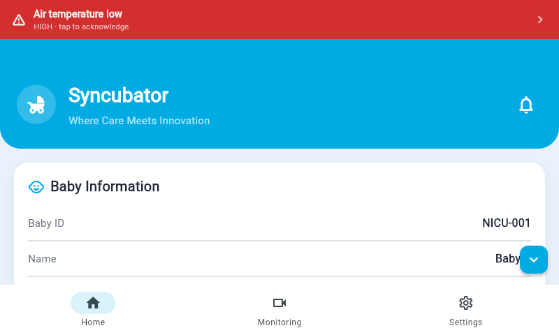
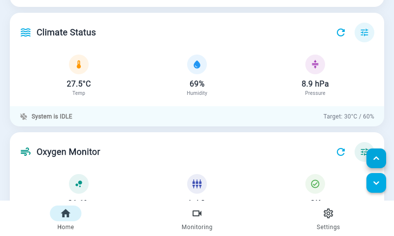

# Syncubator

**A neonatal incubator with prioritised alarms, closed-loop climate control and remote monitoring.**

Syncubator is a working incubator prototype built by Team Syncubator at the Indian Institute of Technology Mandi
(mentor: Dr. Gajendra Singh). A Raspberry Pi 4 reads the sensors, holds the baby's surroundings steady, raises alarms
on the incubator itself, and serves one Flutter app that runs on the incubator's touchscreen, on Android phones and on a
secure website.

> **Research prototype.** Syncubator is not a certified medical device. Any clinical use needs regulatory approval and
> testing to IEC 60601-1-8 and IEC 60601-2-19. See [Safety and use](#safety-and-use).

<p>
  
  
</p>

## What it does

| Area | What Syncubator provides |
|---|---|
| **Climate** | Air temperature (two TMP117 + BME680), humidity (BME680 + MS8607) and pressure, held at the operator's set points by a dead-band controller driving two heaters and a humidifier. A failed sensor is dropped from the average. |
| **Oxygen** | Electrochemical O2 cell read through an ADS1115, with automatic inflow control: an 8-position servo valve opened or closed around a target percentage. |
| **Vital signs** | SpO2 and pulse from a Contec CMS60C oximeter (USB serial), and skin temperature from a YSI-400 probe (ADS1115, Steinhart-Hart conversion). |
| **Weight and bed** | Four load cells with HX711 amplifiers (with tare), and a motorised mattress whose travel is gated by a VL53L4CD time-of-flight sensor. |
| **Lid and light** | A linear-actuator lid with timed Open and Close and a one-step safety rule, and a relay-switched phototherapy light. |
| **Alarms** | 20 alarm conditions in the low, medium and high priorities of IEC 60601-1-8, evaluated on the incubator every second: onset delay, latching, acknowledge, a distinct buzzer rhythm per priority, sensor-fault handling, an SOS call, and a smoke alarm. Works with no network and no app. |
| **App** | One Flutter code base: full-screen Chromium kiosk on the incubator's touchscreen, Android app, and a public website behind an e-mail one-time-PIN login. Live camera view, alarm banner, editable alarm limits. |

## How it fits together

```
 Sensors (I2C, GPIO, ADC, USB, CSI)            Actuators (relays, L298N, servo, buzzer)
            │                                              ▲
            ▼                                              │
   ┌───────────────────────────── Raspberry Pi 4 ──────────────────────────────┐
   │  sensor threads ─► shared state ─► control loops ─► actuators            │
   │                         │      └──► alarm engine ─► buzzer                │
   │                         ▼                                                  │
   │                   Flask API  ◄── Gunicorn (localhost only)                │
   └─────────────────────────┬──────────────────────────────────────────────────┘
                             ▼
                  Nginx (HTTPS, serves the web app)
        ┌────────────────────┼──────────────────────────┐
        ▼                    ▼                          ▼
 Touchscreen kiosk      Android app          Public website (Cloudflare
 (Chromium, Flutter)    (Flutter)            Tunnel + Access login)
```

A longer description is in [docs/architecture.md](docs/architecture.md).

## Repository layout

| Path | Contents |
|---|---|
| [`raspberry_pi/`](raspberry_pi/) | Flask backend `app.py`, requirements, deployment files (`deploy/`), sample data (`sample_data/`) and the backend tests (`tests/`) |
| [`lib/`](lib/) | Flutter app: models, services, providers, screens, widgets |
| [`test/`](test/) | Flutter widget tests |
| [`web/`](web/), [`android/`](android/), [`assets/`](assets/) | Flutter web and Android targets, icons and the pinned certificate |
| [`website/`](website/) | Static public information page |
| [`docs/`](docs/) | Architecture, hardware, API, alarms, deployment and testing documents, plus the design documentation PDF |

## Quick start

### Try the app with no hardware (demo mode)

The app ships with a simulated-data mode, so you can see every screen without an incubator.

```bash
flutter pub get
flutter run -d chrome          # demo mode is the default
```

### Run the backend tests (any computer)

The tests run the real `app.py` against fake sensors, so no Raspberry Pi is needed.

```bash
cd raspberry_pi
python -m venv .venv && source .venv/bin/activate     # Windows: .venv\Scripts\activate
pip install -r requirements-test.txt
pytest tests
```

### Run it on an incubator

Follow [docs/deployment.md](docs/deployment.md): wire the hardware ([docs/hardware.md](docs/hardware.md)), set up the
Raspberry Pi, build the app with `--dart-define=USE_MOCK_DATA=false`, and start the service.

## Documentation

| Document | What is in it |
|---|---|
| [docs/architecture.md](docs/architecture.md) | Components, threads, shared state, settings, security, app structure |
| [docs/hardware.md](docs/hardware.md) | Sensors, actuators, pin map, wiring notes, the skin-probe circuit |
| [docs/api.md](docs/api.md) | Every HTTP endpoint with request and response examples |
| [docs/alarms.md](docs/alarms.md) | Alarm engine behaviour and the alarm list |
| [docs/deployment.md](docs/deployment.md) | Raspberry Pi setup, HTTPS, Nginx, systemd, kiosk, public website, building the app |
| [docs/testing.md](docs/testing.md) | The test suites, what they cover, and how to run them |
| [docs/Syncubator_Design_Documentation.pdf](docs/Syncubator_Design_Documentation.pdf) | Full design document, including the mechanical design |

## Sample data

[`raspberry_pi/sample_data/`](raspberry_pi/sample_data/) holds real responses from the backend:
`status_example.json` (a normal `/status`), `status_with_alarm_example.json` (a humidity alarm raised) and
`config.example.json` (the settings file the backend saves). A test keeps them in step with the live API.

## Tests

* **Backend:** 32 tests (`pytest`) covering the skin-probe curve and reading states, every alarm rule, the alarm
  lifecycle through the running engine, dead-band heater control, the lid rule, the phototherapy relay, input
  validation, settings persistence and the sample data.
* **App:** 6 widget tests (`flutter test`) covering the lid, skin, phototherapy and SOS controls and an app smoke test.

## Safety and use

* Syncubator is a **research prototype and not a certified medical device.**
* Built-in protections: every relay starts off, the phototherapy light is always off after a restart, the lid can only
  be opened one step before it is closed, alarms run on the incubator without a network, and a failed sensor raises a
  fault instead of a believable wrong reading.
* Mains-powered parts (heaters, humidifier) need their own fuses and an enclosure that cannot be touched.

## License

[MIT](LICENSE) © 2026 Team Syncubator, IIT Mandi.
