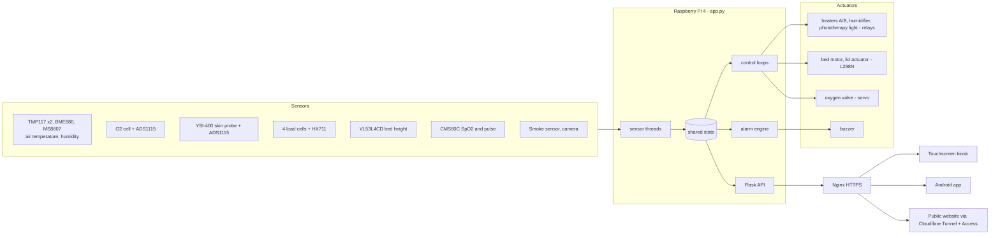

# Architecture

## Overview



## Backend (`raspberry_pi/app.py`)

A single Python program, started by Gunicorn (one worker, eight threads, bound to `127.0.0.1:5000`).

* **Sensor threads** read each device on its own cadence and write into one shared `state` dictionary guarded by a lock.
  Threads: weight, climate (2 s), bed height (0.2 s), oxygen, SpO2 (0.5 s), smoke (0.5 s), skin probe (1 s), the alarm
  engine (1 s), the buzzer, and a start-up thread for the load cells. A device that fails to start leaves its section
  in a fault state; it never stops the program.
* **Control loops** compare the state with the operator's set points. Heaters, humidifier and the oxygen valve use a
  dead band (hysteresis) so relays do not chatter. The bed is gated by the time-of-flight reading and a 20 s time-out.
  The lid uses timed moves and a one-step rule because it has no position sensor.
* **Alarm engine** evaluates 20 conditions every second on the incubator itself (see [alarms.md](alarms.md)).
* **Flask API** exposes the state at `GET /status` and accepts commands (see [api.md](api.md)).
* **Settings** (set points, alarm limits, monitoring switches, lid position, calibration) are saved to `config.json`,
  written atomically so a power cut, even in the middle of a write, cannot corrupt it. Live readings and momentary
  states (`moving`, relay outputs, the phototherapy light) are never saved, so they always start from the real hardware
  state after a restart.
* **Shared ADC:** the O2 cell (A0) and the skin probe (A3) use the same ADS1115 multiplexer, so both read under one lock.

### Fail-safe behaviour

* Every relay pin is made an output already set to "off" (the relay boards are active low), so nothing switches on while
  the program starts.
* The phototherapy light is off after every restart.
* If no temperature sensor answers, the climate section reports a fault and the temperature alarms are suppressed
  in favour of a single sensor-fault alarm.
* `Open` on the lid is refused until `Close` has been used; any lid command is refused while it moves.

## Network path and security

```
Client ──HTTPS 443──► Nginx ──HTTP──► Gunicorn 127.0.0.1:5000 ──► Flask
```

* Gunicorn listens on localhost only; the API is reachable only through Nginx over HTTPS.
* The phone app trusts only the incubator's pinned self-signed certificate (`assets/certs/syncubator.crt`).
* The public website is reached through a Cloudflare Tunnel, behind Cloudflare Access (e-mail one-time-PIN login). A
  small Cloudflare Worker shows an "incubator offline" page when the Pi is down. No inbound port is opened on the
  incubator's network.
* No tokens or keys are stored in this repository (see `.gitignore`).

## App (`lib/`)

Flutter, with a Provider + Service + Model structure.

| Layer | Folder | Role |
|---|---|---|
| Models | `lib/models/` | Plain data classes parsed from `/status` |
| Services | `lib/services/` | HTTP calls to the Pi (or simulated data in demo mode) |
| Providers | `lib/providers/` | State and polling (once a second); notify the widgets |
| Widgets and screens | `lib/widgets/`, `lib/screens/` | One card per subsystem on the home screen, a monitoring (camera) screen, settings |
| Utilities | `lib/utils/` | API constants, colours, the pinned-certificate HTTP client |

* **Demo mode** (`USE_MOCK_DATA`, true by default) returns simulated data so the whole interface runs with no incubator.
* **One build, three places:** the same web build runs in the touchscreen kiosk and on the public website (build with an
  empty `API_BASE_URL` so it calls the origin it was loaded from); the Android app is the same code.
* **Touchscreen details:** the kiosk passes taps but not drags, so scrolling uses arrow buttons; the alarm tone comes
  from the Pi's buzzer because Chromium blocks audio until the first tap; a hidden long press on the header icon leaves
  the kiosk for the Pi desktop.
* The camera stream is MJPEG; `camera_stream_card.dart` decodes it frame by frame.
